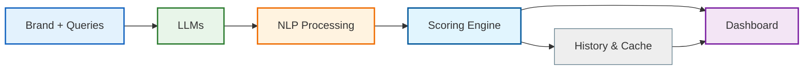

# GEO Analytics — AI Brand Visibility Intelligence

> **Google Search Console — but for AI models.**

[](https://fastapi.tiangolo.com/)
[](https://reactjs.org/)
[](https://python.org/)
[](https://ollama.com/)
[](LICENSE)

---

## What Is GEO Analytics?

**GEO (Generative Engine Optimization) Analytics** tracks how visible a brand is inside AI-generated responses.

When someone asks an AI assistant:

> *"What are the best payment apps in India?"*

Is your brand mentioned? In what position? With what sentiment?

Traditional search has Google Search Console for that. AI search has nothing like it — until now.

GEO Analytics gives a brand a **0–100 visibility score** based on real AI model responses, along with actionable recommendations to improve it.

```
Brand + Queries → AI Models → NLP Analysis → Score → Dashboard + Recommendations
```

---

## Features

- **Multi-query analysis** — run several search queries for one brand at once
- **Dual-model analysis** — two Gemma prompts, Precise and Creative, using the same `gemma3:1b` model via Ollama
- **NLP entity detection** — spaCy named entity recognition for brand mentions
- **Sentiment analysis** — VADER sentiment scoring per mention
- **Visibility scoring** — custom 0–100 GEO score algorithm (see below)
- **Actionable recommendations** — specific steps to improve AI visibility
- **Industry benchmark** — compare a score against market averages
- **Radar profile** — multi-dimensional visibility breakdown
- **One-click demo mode** — a full sample report with no LLM setup, clearly labelled as sample data
- **History and trends** — every successful analysis is saved to SQLite, with history and trend views
- **Multi-brand comparison** — compare 2–3 brands on the same queries, side by side, with CSV export
- **Caching** — repeat analyses are cached by a SHA-256 hash of brand + queries + model identifiers, with a configurable TTL
- **Per-model latency** — latency is recorded per model where the LLM response provides it
- **Runs locally** — no external API keys, no API cost, no quota limits

---

## Demo

```
Brand: Google Pay
Query: Best UPI payment app in India?

Result:
├── GEO Score: 77 / 100
├── Grade: A — Strong Presence
├── Gemma Precise: 77 (early position, positive sentiment)
├── Gemma Creative: 77 (early position, positive sentiment)
└── Recommendation: Expand to adjacent query topics
```

Try it without any model setup: open the dashboard and click **Try Sample (No LLM)**, or call `GET /demo/sample`. The sample brand is the fictional **NovaPay (Sample)**, and the response is flagged with `is_sample: true`.

---

## Architecture



```
geo-analytics/
│
├── backend/                    # FastAPI Python server
│   ├── app/
│   │   ├── api/                # history, compare, jobs routers
│   │   ├── core/               # config, database, cache
│   │   ├── data/
│   │   │   └── sample_report.json  # demo-mode sample report
│   │   ├── models/             # SQLAlchemy models
│   │   ├── services/
│   │   │   ├── llm_service.py      # Ollama / Gemma calls
│   │   │   ├── nlp_service.py      # spaCy + VADER analysis
│   │   │   ├── scoring_service.py  # 0–100 scoring algorithm
│   │   │   └── analysis_pipeline.py  # shared pipeline, caching, latency
│   │   └── main.py             # FastAPI app and routes
│   ├── .env.example
│   └── requirements.txt
│
├── frontend/                   # React + Vite dashboard
│   └── src/
│       ├── App.jsx             # Main dashboard UI
│       └── api.js              # Backend API calls
│
├── docs/
│   └── demo-script.md          # 90-second demo script
├── docker-compose.yml
└── README.md
```

---

## Tech Stack

### Backend

| Technology | Purpose |
|---|---|
| FastAPI | REST API server |
| Python 3.11+ | Core language |
| Ollama | Local LLM runner |
| Gemma 3 1B (`gemma3:1b`) | AI model, via Ollama |
| spaCy | NLP entity detection |
| VADER Sentiment | Sentiment analysis |
| SQLAlchemy + SQLite | History persistence |
| Uvicorn | ASGI server |

### Frontend

| Technology | Purpose |
|---|---|
| React 19 + Vite | UI framework |
| Recharts | Data visualisation |
| Tailwind CSS | Styling |
| Axios | API calls |

---

## Quick Start

### Prerequisites

- Python 3.11+
- Node.js 20+
- Ollama — https://ollama.com/download
- Docker (optional, for the one-command run)

Check your versions:

```bash
python --version    # 3.11+
node --version      # 20+
ollama --version    # any
```

### Option A — One-command run (Docker)

```bash
docker compose up
```

This starts the backend on port 8000 and the frontend on port 5173.

### Option B — Local run

**1. Clone the repository**

```bash
git clone https://github.com/codebyzerone/GEO-ANALYTICS.git
cd GEO-ANALYTICS
```

**2. Pull the AI model**

```bash
ollama pull gemma3:1b
```

This downloads Gemma 3 1B (~800 MB). Only needed once.

**3. Backend**

```bash
cd backend

# Create a virtual environment
python -m venv .venv

# Activate it
# Windows:
.venv\Scripts\activate
# macOS / Linux:
source .venv/bin/activate

# Install dependencies
pip install -r requirements.txt

# Download the spaCy language model
python -m spacy download en_core_web_sm

# Copy the example environment file
cp .env.example .env

# Start the server
uvicorn app.main:app --reload
```

Backend runs at: `http://127.0.0.1:8000`

**4. Frontend**

Open a new terminal:

```bash
cd frontend
npm install
npm run dev
```

Frontend runs at: `http://localhost:5173`

**5. Open the app**

```
http://localhost:5173
```

---

## How to Use

1. **Enter a brand name** — for example, `Razorpay`
2. **Enter queries** — one per line, related to the brand's industry
3. **Run the analysis** — click the button and wait; local LLM calls take 1–3 minutes per batch on CPU
4. **View the results** — GEO score, breakdown, and recommendations
5. **Switch tabs** — explore Overview, Breakdown, Radar, and Trends
6. **Try the sample** — click **Try Sample (No LLM)** to see a full report without running a model

### Example queries

```
# Payment apps
Best payment gateway for Indian startups?
Which UPI app should I use for my business?

# Food delivery
Best food delivery app in India?
Which app has the fastest delivery?

# EdTech
Best online learning platform in India?
Which app is best for JEE preparation?
```

---

## Scoring Algorithm

The GEO score (0–100) is calculated per query as:

```
Score = Mention base (40)
      + Position score (25)   → early = 25, middle = 15, late = 5, not mentioned = 0
      + Sentiment score (20)  → positive = 20, neutral = 10, negative = 2
      + Frequency score (15)  → mention count, capped at 3 mentions
```

The overall score is the average across all queries and both Gemma prompts.

| Score | Grade | Meaning |
|---|---|---|
| 75–100 | A — Strong Presence | Strong AI presence |
| 50–74 | B — Moderate Presence | Moderate presence |
| 25–49 | C — Weak Presence | Needs improvement |
| 0–24 | D — Nearly Invisible | Barely or never mentioned |

---

## API Reference

| Endpoint | Method | Description |
|---|---|---|
| `/` | GET | Root endpoint, returns service status |
| `/health` | GET | Health check |
| `/demo/sample` | GET | Sample report, no LLM required, flagged `is_sample: true` |
| `/analyze` | POST | Analyse a brand across multiple queries (synchronous) |
| `/history` | GET | Analysis history, optionally filtered by `?brand=` |
| `/history/init` | POST | Create the history table (idempotent) |
| `/trends` | GET | Scores over time for a brand (`?brand=` required) |
| `/compare` | POST | Compare 2–3 brands on the same queries |
| `/export/csv` | GET | Export a brand's analysis as CSV |
| `/jobs/{job_id}` | GET | Poll an async job for status and result |

### Analyse a brand

```http
POST /analyze
Content-Type: application/json

{
  "brand_name": "Razorpay",
  "queries": [
    "Best payment gateway in India?",
    "Which payment solution for startups?"
  ]
}
```

**Response:**

```json
{
  "brand": "Razorpay",
  "total_queries": 2,
  "average_geo_score": 72.5,
  "query_reports": [
    {
      "query": "Best payment gateway in India?",
      "overall_score": 77.0,
      "grade": "A — Strong Presence",
      "per_llm": {
        "gemma_precise": {
          "score": 77.0,
          "mentioned": true,
          "position": "early",
          "sentiment": "positive",
          "mention_count": 2
        },
        "gemma_creative": {
          "score": 55.0,
          "mentioned": true,
          "position": "middle",
          "sentiment": "neutral",
          "mention_count": 1
        }
      }
    }
  ]
}
```

---

## Environment Variables

Copy `.env.example` to `.env` in `backend/` and adjust as needed. No secrets are required for local development.

| Variable | Default | Description |
|---|---|---|
| `APP_NAME` | `GEO Analytics API` | Application name |
| `APP_VERSION` | `1.0.0` | Application version |
| `CORS_ALLOW_ORIGINS` | `http://localhost:5173,http://127.0.0.1:5173` | Allowed frontend origins |
| `CACHE_TTL_SECONDS` | `600` | Cache lifetime, in seconds |
| `DATABASE_URL` | `sqlite:///./geo_analytics.db` | SQLite database path for history |
| `OLLAMA_HOST` | `http://127.0.0.1:11434` | Ollama server address |
| `OLLAMA_MODEL` | `gemma3:1b` | Model used for every LLM call |

No external API keys are required. All AI runs locally via Ollama.

---

## Development Workflow

```bash
# Backend only
cd backend && uvicorn app.main:app --reload

# Frontend only
cd frontend && npm run dev

# Full stack with Docker
docker compose up

# Run backend tests
cd backend && python -m pytest
```

A 90-second demo script is in `docs/demo-script.md`.

---

## Roadmap

- [x] Core NLP pipeline (spaCy + VADER)
- [x] Dual-model analysis (Gemma Precise + Creative)
- [x] 0–100 GEO scoring algorithm
- [x] React dashboard with charts
- [x] Recommendations engine
- [x] Industry benchmark comparison
- [x] Historical score tracking (database)
- [x] Competitor comparison mode
- [ ] Multi-language query support
- [ ] Cloud deployment (Railway + Vercel)
- [ ] Email alerts for score changes
- [ ] API key for external integrations
- [ ] Support for more LLMs (Mistral, LLaMA)

---

## Contributing

Contributions are welcome. Here's how:

```bash
# Fork the repo, then create your branch
git checkout -b feature/your-feature

# Make changes and commit
git commit -m "feat: add your feature"

# Push and create a PR
git push origin feature/your-feature
```

---

## Performance Note

Running Gemma locally on CPU takes **1–3 minutes per query batch**. This is normal for consumer hardware without a dedicated GPU.

For faster results, use fewer queries (1–2 per analysis), or use GPU-enabled hardware for production use.

---

## Built By

**Manodip Bhattacharjee**
B.Tech Computer Science & Engineering
Guru Nanak Institute of Technology, Kolkata

---

## License

This project is licensed under the MIT License — see the [LICENSE](LICENSE) file for details.

---

## Acknowledgements

- [Ollama](https://ollama.com/) — local LLM infrastructure
- [Google Gemma](https://ai.google.dev/gemma) — open-source AI model
- [spaCy](https://spacy.io/) — industrial NLP library
- [VADER Sentiment](https://github.com/cjhutto/vaderSentiment) — sentiment analysis
- [FastAPI](https://fastapi.tiangolo.com/) — modern Python web framework
- [Recharts](https://recharts.org/) — React charting library

---

<div align="center">

**GEO Analytics** · Open Source · AI Visibility Intelligence

*Track. Score. Dominate.*

</div>
