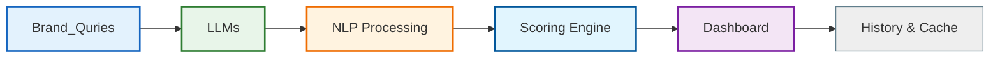

<<<<<<< HEAD
# GEO Analytics

## Overview

GEO Analytics is a full-stack application that analyzes brand visibility across large language models, provides sentiment analysis, and offers a dashboard for viewing results and trends.

## Architecture



## API Endpoints

| Endpoint | Method | Description |
|---|---|---|
| `/` | GET | Root endpoint, returns service status |
| `/health` | GET | Health check endpoint |
| `/demo/sample` | GET | Returns a demo/sample report (no LLM required) |
| `/analyze` | POST | Analyze a brand across multiple queries (sync + async job) |
| `/jobs/{id}` | GET | Poll for async job result |
| `/history` | GET | Returns analysis history, optionally filtered by brand |
| `/compare` | POST | Compare 2-3 brands side-by-side |
| `/export/csv` | GET | Export a brand's analysis as CSV |

## Local Development

### Prerequisites

- Python 3.11+
- Node.js 20+
- Docker (optional, for containerized development)

### Backend

```bash
cd backend
python -m venv .venv
.venv\\Scripts\\activate
pip install -r requirements.txt
# Set env vars from .env.example
cp .env.example .env
# Start the server
uvicorn app.main:app --host 0.0.0.0 --port 8000
```

### Frontend
=======
# 🔍 GEO Analytics — AI Brand Visibility Intelligence

> **Google Search Console — but for AI models.**

[](https://fastapi.tiangolo.com/)
[](https://reactjs.org/)
[](https://python.org/)
[](https://ollama.com/)
[](LICENSE)

---

## 📌 What Is GEO Analytics?

**GEO (Generative Engine Optimization) Analytics** is an open-source platform that tracks how visible your brand is inside AI-generated responses — across models like Gemma, LLaMA, and more.

When someone asks an AI assistant:
> *"What are the best payment apps in India?"*

Is **your brand** mentioned? In what position? With what sentiment?

You have no idea. Until now.

---

## 🧠 The Problem

| Traditional Search | AI Search |
|-------------------|-----------|
| Customer Googles → you track rankings | Customer asks AI → you track **nothing** |
| Google Search Console shows impressions | No equivalent tool exists for AI |
| SEO strategy is mature | GEO strategy is brand new |

**Millions of buying decisions are being made through AI assistants every day. Brands are invisible to this shift.**

---

## 💡 Our Solution

GEO Analytics gives brands a **0-100 visibility score** based on real AI model responses — along with actionable recommendations to improve their presence.

```
Brand + Queries → AI Models → NLP Analysis → Score → Dashboard + Recommendations
```

---

## ✨ Features

- 🔍 **Multi-query Analysis** — Fire multiple search queries at once
- 🤖 **Dual AI Model Support** — Compare responses across 2 Gemma models
- 📊 **NLP Entity Detection** — spaCy-powered brand mention detection
- 💬 **Sentiment Analysis** — VADER sentiment scoring per mention
- 📈 **Visibility Scoring** — Custom 0-100 GEO score algorithm
- 🎯 **Actionable Recommendations** — Specific steps to improve AI visibility
- 📉 **Industry Benchmark** — Compare your score vs market averages
- 🌐 **Radar Profile** — Multi-dimensional visibility breakdown
- ⚡ **Runs Locally** — Zero API cost, zero quota limits
- 🎨 **Cyberpunk Dashboard** — Professional dark UI with real-time animations

---

## 🖥️ Demo

```
Brand: Google Pay
Query: Best UPI payment app in India?

Result:
├── GEO Score: 77 / 100
├── Grade: DOMINANT
├── Gemma Precise: 77 (early position, positive sentiment)
├── Gemma Creative: 77 (early position, positive sentiment)
└── Recommendation: Expand to adjacent query topics
```

---

## 🏗️ Architecture

```
geo-analytics/
│
├── backend/                    # FastAPI Python server
│   ├── app/
│   │   ├── services/
│   │   │   ├── llm_service.py      # Ollama/Gemma API calls
│   │   │   ├── nlp_service.py      # spaCy + VADER analysis
│   │   │   └── scoring_service.py  # 0-100 scoring algorithm
│   │   └── main.py                 # FastAPI routes
│   ├── .env                        # API keys (not committed)
│   └── requirements.txt
│
└── frontend/                   # React + Vite dashboard
    └── src/
        ├── App.jsx                 # Main dashboard UI
        └── api.js                  # Backend API calls
```

---

## ⚙️ Tech Stack

### Backend
| Technology | Purpose |
|-----------|---------|
| FastAPI | REST API server |
| Python 3.11 | Core language |
| Ollama | Local LLM runner |
| Gemma 3 1B | AI model (via Ollama) |
| spaCy | NLP entity detection |
| VADER Sentiment | Sentiment analysis |
| Uvicorn | ASGI server |

### Frontend
| Technology | Purpose |
|-----------|---------|
| React + Vite | UI framework |
| Recharts | Data visualization |
| Tailwind CSS | Styling |
| Axios | API calls |

---

## 🚀 Quick Start

### Prerequisites

Make sure you have these installed:

```bash
# Check versions
python --version    # 3.11+
node --version      # 18+
ollama --version    # any
```

- **Python 3.11+** → https://python.org/downloads
- **Node.js 18+** → https://nodejs.org
- **Ollama** → https://ollama.com/download

---

### Step 1 — Clone The Repository

```bash
git clone https://github.com/YOUR_USERNAME/geo-analytics.git
cd geo-analytics
```

---

### Step 2 — Pull AI Model

```bash
ollama pull gemma3:1b
```

This downloads the Gemma 3 1B model (~800MB). Only needed once.

---

### Step 3 — Backend Setup

```bash
cd backend

# Create virtual environment
python -m venv venv

# Activate it
# Windows:
venv\Scripts\activate
# Mac/Linux:
source venv/bin/activate

# Install dependencies
pip install -r requirements.txt

# Download spaCy language model
python -m spacy download en_core_web_sm
```

---

### Step 4 — Environment Variables

Create a `.env` file inside the `backend` folder:

```bash
# backend/.env
DATABASE_URL=sqlite:///./geo.db
```

> No API keys needed — everything runs locally via Ollama.

---

### Step 5 — Run Backend

```bash
# Make sure you're in /backend with venv activated
uvicorn app.main:app --reload
```

Backend runs at: `http://127.0.0.1:8000`

---

### Step 6 — Frontend Setup

Open a new terminal:
>>>>>>> origin/main

```bash
cd frontend
npm install
npm run dev
```

<<<<<<< HEAD
### Environment Variables (.env.example)

```env
APP_NAME=GEO Analytics API
APP_VERSION=1.0.0
CORS_ALLOW_ORIGINS=http://localhost:5173,http://127.0.0.1:5173
CACHE_TTL_SECONDS=600
DATABASE_URL=sqlite:///./geo_analytics.db
```

### One-Command Run (Docker)

```bash
docker compose up
```

This starts both the backend (port 8000) and frontend (port 5173).

## Demo Mode

Use `GET /demo/sample` to test the API without Ollama or any LLM setup. The response is a clearly fictional/sample report labeled with `is_sample: true` and `source: "demo"`.

## Development Workflow

1. **Backend only**: `cd backend && uvicorn app.main:app --reload`
2. **Frontend only**: `cd frontend && npm run dev`
3. **Full stack with Docker**: `docker compose up`
4. **Run tests**: `cd backend && python -m pytest`
=======
Frontend runs at: `http://localhost:5173`

---

### Step 7 — Open The App

```
http://localhost:5173
```

---

## 📖 How To Use

1. **Enter Brand Name** — Type the brand you want to analyze (e.g. `Razorpay`)
2. **Enter Queries** — Add search queries (one per line) that relate to your industry
3. **Execute Analysis** — Click the button and wait 1-3 minutes
4. **View Results** — Check your GEO score, breakdown, and recommendations
5. **Switch Tabs** — Explore OVERVIEW, BREAKDOWN, and RADAR views

### Example Queries by Industry

```
# Payment Apps
Best payment gateway for Indian startups?
Which UPI app should I use for my business?

# Food Delivery
Best food delivery app in India?
Which app has the fastest delivery?

# EdTech
Best online learning platform in India?
Which app is best for JEE preparation?

# Any Brand
Best [your industry] in India?
Top [your category] for [your audience]?
```

---

## 📊 Scoring Algorithm

The GEO Score (0-100) is calculated as:

```
Score = Mention Base (40)
      + Position Score (25)   → early=25, middle=15, late=5
      + Sentiment Score (20)  → positive=20, neutral=10, negative=2
      + Frequency Score (15)  → based on mention count
```

| Score Range | Grade | Meaning |
|------------|-------|---------|
| 75 - 100 | DOMINANT | Strong AI presence |
| 50 - 74 | VISIBLE | Moderate presence |
| 25 - 49 | WEAK | Needs improvement |
| 0 - 24 | INVISIBLE | Not mentioned |

---

## 🔌 API Reference

### Analyze Brand

```http
POST /analyze
Content-Type: application/json

{
  "brand_name": "Razorpay",
  "queries": [
    "Best payment gateway in India?",
    "Which payment solution for startups?"
  ]
}
```

**Response:**
```json
{
  "brand": "Razorpay",
  "total_queries": 2,
  "average_geo_score": 72.5,
  "query_reports": [
    {
      "query": "Best payment gateway in India?",
      "overall_score": 77.0,
      "grade": "A — Strong Presence",
      "per_llm": {
        "gemma_precise": {
          "score": 77.0,
          "mentioned": true,
          "position": "early",
          "sentiment": "positive",
          "mention_count": 2
        },
        "gemma_creative": {
          "score": 55.0,
          "mentioned": true,
          "position": "middle",
          "sentiment": "neutral",
          "mention_count": 1
        }
      }
    }
  ]
}
```

---

## 🗺️ Roadmap

- [x] Core NLP pipeline (spaCy + VADER)
- [x] Dual model analysis (Gemma Precise + Creative)
- [x] 0-100 GEO scoring algorithm
- [x] React dashboard with charts
- [x] Recommendations engine
- [x] Industry benchmark comparison
- [ ] Historical score tracking (database)
- [ ] Competitor comparison mode
- [ ] Multi-language query support
- [ ] Cloud deployment (Railway + Vercel)
- [ ] Email alerts for score changes
- [ ] API key for external integrations
- [ ] Support for more LLMs (Mistral, LLaMA)

---

## 🤝 Contributing

Contributions are welcome! Here's how:

```bash
# Fork the repo
# Create your branch
git checkout -b feature/your-feature

# Make changes and commit
git commit -m "feat: add your feature"

# Push and create PR
git push origin feature/your-feature
```

---

## 📁 Environment Variables

| Variable | Required | Description |
|---------|----------|-------------|
| `DATABASE_URL` | Yes | SQLite database path |

> No external API keys required. All AI runs locally via Ollama.

---

## ⚠️ Performance Note

Running Gemma locally on CPU takes **1-3 minutes per query batch**. This is normal for consumer hardware without a dedicated GPU.

For faster results:
- Use fewer queries (1-2 per analysis)
- Consider GPU-enabled hardware for production use

---

## 👨‍💻 Built By

**Manodip Bhattacharjee**
B.Tech Computer Science & Engineering
Guru Nanak Institute of Technology, Kolkata

---

## 📄 License

This project is licensed under the MIT License — see the [LICENSE](LICENSE) file for details.

---

## 🙏 Acknowledgements

- [Ollama](https://ollama.com/) — Local LLM infrastructure
- [Google Gemma](https://ai.google.dev/gemma) — Open source AI model
- [spaCy](https://spacy.io/) — Industrial NLP library
- [VADER Sentiment](https://github.com/cjhutto/vaderSentiment) — Sentiment analysis
- [FastAPI](https://fastapi.tiangolo.com/) — Modern Python web framework
- [Recharts](https://recharts.org/) — React charting library

---

<div align="center">

**GEO Analytics** · Open Source · AI Visibility Intelligence

*Track. Score. Dominate.*

</div>
>>>>>>> origin/main
