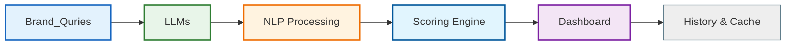

# GEO Analytics

## Overview

GEO Analytics is a full-stack application that analyzes brand visibility across large language models, provides sentiment analysis, and offers a dashboard for viewing results and trends.

## Architecture



## API Endpoints

| Endpoint | Method | Description |
|---|---|---|
| `/` | GET | Root endpoint, returns service status |
| `/health` | GET | Health check endpoint |
| `/demo/sample` | GET | Returns a demo/sample report (no LLM required) |
| `/analyze` | POST | Analyze a brand across multiple queries (sync + async job) |
| `/jobs/{id}` | GET | Poll for async job result |
| `/history` | GET | Returns analysis history, optionally filtered by brand |
| `/compare` | POST | Compare 2-3 brands side-by-side |
| `/export/csv` | GET | Export a brand's analysis as CSV |

## Local Development

### Prerequisites

- Python 3.11+
- Node.js 20+
- Docker (optional, for containerized development)

### Backend

```bash
cd backend
python -m venv .venv
.venv\\Scripts\\activate
pip install -r requirements.txt
# Set env vars from .env.example
cp .env.example .env
# Start the server
uvicorn app.main:app --host 0.0.0.0 --port 8000
```

### Frontend

```bash
cd frontend
npm install
npm run dev
```

### Environment Variables (.env.example)

```env
APP_NAME=GEO Analytics API
APP_VERSION=1.0.0
CORS_ALLOW_ORIGINS=http://localhost:5173,http://127.0.0.1:5173
CACHE_TTL_SECONDS=600
DATABASE_URL=sqlite:///./geo_analytics.db
```

### One-Command Run (Docker)

```bash
docker compose up
```

This starts both the backend (port 8000) and frontend (port 5173).

## Demo Mode

Use `GET /demo/sample` to test the API without Ollama or any LLM setup. The response is a clearly fictional/sample report labeled with `is_sample: true` and `source: "demo"`.

## Development Workflow

1. **Backend only**: `cd backend && uvicorn app.main:app --reload`
2. **Frontend only**: `cd frontend && npm run dev`
3. **Full stack with Docker**: `docker compose up`
4. **Run tests**: `cd backend && python -m pytest`